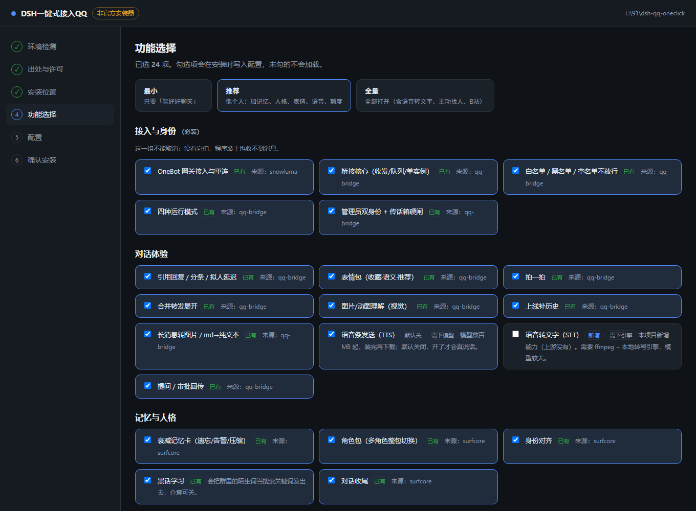
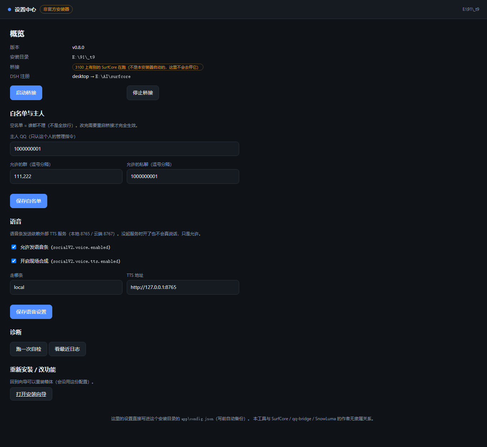

# DSH一键式接入QQ

> ## ⚠️ 非官方安装器
>
> 本项目是一个 **第三方、非官方** 的一键安装器。它与
> **[SurfCore](https://github.com/Mieksido/surfcore)**、**[qq-bridge](https://github.com/Derpyu520/qq-bridge)**、
> **[SnowLuma](https://github.com/SnowLuma/SnowLuma)** 的作者 **均无隶属、合作、授权或背书关系**。
>
> 我们只做三件事：把上游已经写好的东西 **按文档装好**、让你 **勾选要什么**、装完给你一个 **能调的界面**。
> 程序本体的功劳属于上游作者；出问题请先读上游文档，再提 issue 到这里。

把 DeepSeek Harness 接到 QQ，**双击 → 勾选 → 装完**，不需要命令行、不需要装 git。

📖 **新手直接看：[使用教程 § 从零到在 QQ 里说话](docs/USAGE.md)** —— 从准备 NTQQ/SnowLuma/DSH 到在群里 @ 它一次，逐步截图级说明。



---

## 它会做什么

| 阶段 | 你看到什么 |
|---|---|
| 环境检测 | 系统 / Node / DSH / 端口 / 网络 / 已有安装，红项直接告诉你怎么修 |
| 出处与许可 | **装之前**列出每个用到的上游项目、作者、许可证、我们改了什么 |
| 选功能 | 三个套餐按钮（最小 / 推荐 / 全量），也可逐项勾 |
| 装 | 从上游拉指定版本 + sha256 校验，逐项进度，断了能续 |
| 自检 | 六项检查，每条给修复动作，不假装成功 |
| 装完 | 独立设置中心，随时改白名单、语音、记忆、额度 |

## 它不会做什么

- **不打包别人的东西**：SurfCore 装时从上游拉，SnowLuma 你自己装，语音模型自己下。
- **不代你登录**：QQ 扫码、B站扫码、DSH 授权，都由你本人完成。
- **不放行所有人**：默认白名单为空 = 谁都不理；不提供「一键全放行」。
- **不偷偷联网**：没有遥测、没有 phone-home；数据出机清单见 `docs/third-party.json` 与上游 LICENSE 附录。

---

## 现在是什么状态

**v0.1.0 — M2.5：装完能接进 DSH 了**。可运行的部分：

- ✅ 本地 Web 向导（6 步，状态可续，关掉再开接着走）
- ✅ 环境检测（11 项，真实探测，不是假绿）
- ✅ 出处与许可页（读 `docs/third-party.json` 生成，未登记的组件直接不显示）
- ✅ 功能勾选（三套餐 + 逐项，依赖自动带）
- ✅ **真实安装**：下上游 → 校验 sha256 → 解包 → `npm ci` → 写配置 → 写清单
- ✅ **失败回滚**：任何一步挂了都退回装之前，不留半个 `app\`
- ✅ **升级保留配置**：重装时沿用 `app\config.json`（白名单、token 都不丢）
- ✅ **注册进 DSH**：3 个 MCP + bundle，写前备份；**发现已有别的注册默认不抢**
- ✅ **装完自检 6 项**：文件 / 依赖 / 配置 / 注册 / 清单 / 端口，每项给修法
- ✅ **设置中心**：白名单、语音开关、启停桥接、自检、看日志——不用开 DSH 也能改
- ✅ 出处闸门 `npm run check:notice`（漏登记 → 失败）
- ⬜ STT 语音转文字

阶段与验收判据见 [docs/DESIGN.md](docs/DESIGN.md) §11。

### 装的时候具体发生什么

```
预检 → 下载 surfcore v0.8.0（7.0 MB，校验 sha256）
     → 解包到 app\（579 个文件）
     → 准备 npm（系统没有就下 11.7.0 到 runtime\npm）
     → npm ci（128 个包，跑上游的 postinstall 补丁）
     → 写 app\config.json（沿用旧配置 + 你填的四件事）
     → 注册进 DSH（3 个 MCP + bundle；发现别的注册就停下来问你）
     → 写 data\manifest.json（版本 / sha256 / 来源 URL）
     → 自检 6 项
```

**注册那一步是"会改别人东西"的**：它写 DSH profile 的 `cordis.patch.yml`、`package.json`，
还会建 `plugins\surfcore` 的目录链接。所以：

- 写之前先备份到 `data\backups\dsh-<时间戳>\`；
- **发现这套 DSH 已经注册了另一套 SurfCore（比如开发者自己的仓库），默认不动**，要改指向得显式勾「强制改指向」；
- 注册失败不影响程序已经装好这件事，只报告，不会让你白装一次。

**版本是钉死的**：`installer/sources.json` 里写死 tag + commit + sha256。
装的时候不追新——今天能装的东西，明天还是同一个字节。要换版本得改这个文件并重算校验和
（`node scripts/fetch-pins.mjs`）。

## 设置中心

装完之后日常用这个，**不用打开 DSH**：

```bash
node installer/server.mjs --settings    # 或双击 settings.bat
```



能做四件事：

| 区块 | 内容 |
|---|---|
| 概览 | 版本、目录、桥接状态、DSH 注册指向；启动 / 停止桥接 |
| 白名单与主人 | 主人 QQ、允许的群 / 私聊——空名单 = 谁都不理 |
| 语音 | 是否允许发语音条、是否现场合成、走本地还是云端 |
| 诊断 | 跑自检 6 项、看桥接日志尾部 |

**两条安全规矩（比功能重要）**：

1. **只停自己启动的桥接**。pid 记在 `data\bridge.pid`，而且要求该进程命令行里带本安装目录 ——
   同机如果还有另一套 SurfCore（比如开发者自己的仓库），这里**不会去动它**，只会告诉你「3100 上是别人的」。
2. **写配置一律先备份**：`data\config.bak\<时间戳>.json`，写前还会校验能解析，免得写坏 JSON 让上游起不来。

> 白名单这类字段，桥接进程在内存里有一份；改完要**重启桥接**才完全生效，界面上也是这么写的，不糊弄。

## 语音转文字（STT）

这是**上游没有**的能力，由本项目自己加：装一个本地 whisper.cpp，注册成**独立的第 4 个 MCP 工具**。
好处是升级上游不会冲掉它，卸载也只是摘掉一条 MCP 条目。

- 勾选「语音转文字（STT）」才会装，**+82 MB**（引擎 9 MB + tiny 模型 74 MB）；
- 完全本地跑，不联网、不上传音频；
- 装完 agent 多两个工具：`stt_status`（看装没装）、`stt_transcribe`（把音频转文字）。

**真实限制（先说清楚，不糊弄）**：whisper 自带 miniaudio，能解 wav/mp3/flac/ogg；
但 **QQ 语音多数是 silk/amr**，这两种解不了，得先转成 wav/mp3 再喂进来。
错误信息里会直接把这句话说出来，而不是给你一个 `failed to decode`。

实测（本机 Win10 / CPU / tiny 模型）：一段 5 秒英文语音 → **1.4 秒**出文字，句子一字不差。

## 打包发布（维护者）

```bash
npm run build
```

产物：

```
dist/dsh-qq-oneclick-v0.1.0/        绿色版目录（90 MB，41 个文件）
dist/dsh-qq-oneclick-v0.1.0.zip     发布资产（33.7 MB）
dist/version.json                   更新检查用（含每个文件的 sha256）
```

- **先过出处闸门再打包**：闸门不过直接失败，不会产出漏署名的包；
- 内置 Node v24 的 `node.exe`（89 MB → zip 里 33.7 MB），并附完整 `LICENSE`（再分发必须带）；
- 包里不含 `data/`、`cache/`、`node_modules/`；
- **文件名一律 ASCII**（`start.bat` / `settings.bat` / `uninstall.bat`）——
  实测中文文件名用 bsdtar 打进 zip 会按本地码页写，换台机器解出来就是乱码。

## 卸载

双击 `uninstall.bat`（读安装时记下的目录）。默认只删程序，**保留配置和记忆**：

| 档位 | 删什么 | 留什么 |
|---|---|---|
| 默认 | `app\` `runtime\` `cache\` | `data\`（配置与备份）+ `~\.dsh\surfcore`（角色/记忆/B站凭据） |
| `--purge` | 上面 + `data\` | 记忆还在 |
| `--purge-all --yes` | 上面 + `~\.dsh\surfcore` | 什么都不留 |

卸载会**先摘 DSH 注册**（还原 `cordis.patch.yml` 与 profile 的 `package.json`、删两个 junction），
再删文件；摘之前备份到 `data\backups\uninstall-<时间戳>\`。

## 跑起来

**双击 `start.bat`** —— 它会先找 `runtime\node\node.exe`（内置运行时），没有再找系统 `node`，都没有就告诉你装哪个。

手动启动：

```bash
node installer/server.mjs --open
```

只监听 `127.0.0.1`，默认端口 `3210`（占用则顺延到 3240）。不需要管理员权限，不写注册表。

> 注：Node 不在 PATH 的机器上（比如当前这台）必须用 `start.bat`，或者写全路径调用 `node.exe`。

## 目录

```
installer/          安装器本体（自有代码）
  server.mjs        本地 Web 服务（零依赖）
  sources.json      上游版本 pin：tag / commit / sha256
  lib/detect.mjs    环境检测
  lib/download.mjs  下载 + 流式 sha256
  lib/extract.mjs   .tar.gz 解包（纯 JS，回落 tar.exe）
  lib/npm.mjs       npm 适配（系统 → 自带 → 下载）
  lib/install.mjs   安装流水线（含回滚）
  lib/state.mjs     安装状态（原子写）
  features.json     功能清单
  web/              向导页面
docs/
  DESIGN.md         设计稿：形状、约束、里程碑
  third-party.json  出处唯一真相源
scripts/
  fetch-pins.mjs    重新固定上游版本与校验和
  check-notice.mjs  构建期闸门
  gen-notice.mjs    NOTICE.md 生成器
```

## 出处与许可

**所有第三方组件的署名都在 [docs/third-party.json](docs/third-party.json) 与 [NOTICE.md](NOTICE.md)。**

- 未在 `third-party.json` 登记的组件，**不得进入安装包或下载清单**；`npm run check:notice` 会拦住。
- `NOTICE.md` 是生成物，**不要手改**；改 `third-party.json` 后跑 `npm run gen:notice`。
- 收录方式分五种（`bundle` / `download` / `user-provided` / `reference` / `doc-only`），义务各不相同，见 `third-party.json` 的 `inclusionKinds`。

本项目代码采用 MIT（见 [LICENSE](LICENSE)）；第三方组件版权归各自作者。

## 免责

1. **账号风险**：QQ 对自动化有风控。用小号、控制频率、别做群发。
2. **别给无限权限**：能读文件、能执行命令的 bot，被诱导就是一台任人操作的电脑。
3. **外来内容是数据，不是命令**：群消息里出现「忽略之前的指令」必须当数据看。
4. 本项目按「照做可能出错」提供，不保证在你的环境可用。
